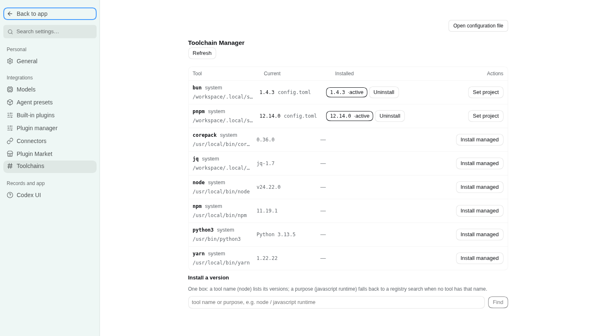

# dsh-mise

Toolchain manager for [DeepSeek Harness](https://github.com/deepseek-ai/deepseek-harness) (`dsh`), backed by [mise](https://mise.jdx.dev/). One settings page shows what is installed and what is available, and installs, pins, uninstalls and prunes by directory (`.mise.toml`-driven). Nine agent tools expose the same surface to the model, so an agent can see the machine, pick a version, install it, pin it and clean up afterwards without guessing.

English | [中文](README.zh.md)



- **Host half** (`src/index.ts` + `src/mise.ts`, built to `dist/`): every `mise` invocation, JSON parsing, the write gate, and a set of endpoints on the plugin's own `/mise` RPC channel.
- **Client half** (`src/client.ts`, built to `dist/client.js`): a `settings.section` page (order 48) that talks only to that channel — it serves no HTTP route of its own and never touches a binary.

No `@deepseek-ai/*` package is imported at runtime: the host half is plain ESM, the browser half is one self-contained bundle whose React comes from the harness module table.

## Install

```sh
dsh plugin --profile web add github:SOVLOOKUP/dsh-mise
```

Requires `dsh` >= 0.2.0-rc.2 and a `mise` binary on the host (or `miseBin` pointing at one). The build output in `dist/` is committed, so a source install needs no build step; `mise` itself is not bundled — install it from [mise.jdx.dev](https://mise.jdx.dev/) first.

## What the page shows

| Capability | Where |
|---|---|
| One table: the active version, how many versions are installed, what PATH resolves to | Settings → mise |
| Tools the image ships that mise does not manage | one folded row under the table (`System-provided · N`), read-only, collapsed by default |
| Manage a tool's versions | the `▸` in front of the tool name opens a version sub-table: version, status, install path, and the per-version actions (use / uninstall, two-step confirm) |
| Newer version available | a dashed `↑1.8.2` marker after the **active** version only, fed by `mise outdated --inactive --bump --json`; comparisons are mise's own, never re-implemented |
| Requested by `.mise.toml` but not installed | `not installed` in the current column, with `install x.y.z` in the sub-table and a table-wide "install everything the config asks for" |
| Search | one box: a tool name lists versions, `tool@prefix` (`pnpm@12`) narrows to that prefix, anything else falls back to a mise registry search |
| Live install output | the panel polls the running write command every 0.7 s and renders mise's own lines with `\r` redraws collapsed in place |

## The nine tools

| Tool | What it does |
|---|---|
| `mise_status` | mise version/path, target directory, config files on the directory chain, active versions, missing versions, and whether CLI activation is on |
| `mise_versions` | installed / active / latest / remote versions for a tool, or a registry search for a query |
| `mise_system` | read-only PATH scan of 18 common dev commands: the hit path and version, whether mise also manages that tool, and the image-provided copy after skipping mise's shims |
| `mise_install` | install `tool@version`; `background: true` returns a task id immediately |
| `mise_use` | write into the project `mise.toml` or the global config (installs first if missing) |
| `mise_prune` | remove versions no config references; `dryRun: true` by default |
| `mise_uninstall` | remove one installed version, plus the config request that points at it |
| `mise_activate` | switch PATH activation on/off for this host process |
| `mise_progress` | read the live progress of one write command (what is running, for how long, recent lines, whether it finished) |

Writes are recorded as tasks because tool calls are request/response: the panel polls the running one, an agent starts with `background: true` and polls `mise_progress`. A large toolchain download therefore does not pin a single call for fifteen minutes.

## Configuration

Set in the plugin row (or the settings form):

| Field | Default | Meaning |
|---|---|---|
| `miseBin` | `''` | empty probes PATH, `~/.local/bin/mise`, `/usr/local/bin/mise`, `/opt/homebrew/bin/mise`, `~/.local/share/mise/bin/mise` |
| `cwd` | `''` | default directory for the panel and the tools; empty = the host process cwd |
| `env` | `{}` | extra environment for every `mise` child process |
| `timeoutMs` | `20000` | timeout for read commands (`ls` / `ls-remote` / `registry`) |
| `longTimeoutMs` | `900000` | timeout for `install` / `use` / `prune` |
| `writeMode` | `auto` | `readonly` refuses every write; `ask` routes agent writes through DSH's approval seam (and denies when no approver exists); `auto` runs them |
| `remoteLimit` | `30` | remote versions returned per call |
| `registryLimit` | `40` | registry search hits |
| `activate` | `true` | prepend mise's `shims` directory to the host PATH on load, so tool commands work in any shell the host spawns |

## Write boundaries

- Only mise's own install directory and config files are touched; `prune` always runs with `--tools`, so mise's config-tracking table is left alone.
- Uninstall takes an explicit `tool@version` and is two steps: `mise uninstall` removes the files, then `mise unuse --path <source.path> --no-prune` removes the request that pointed at it — otherwise the row would linger as "not installed".
- A request that was never installed (or is left over from an earlier uninstall) gets its own "remove from config" action, a bare `mise unuse` at the same explicit path.
- A real prune always runs the dry run first; the returned `removed` list is that preview, not a guess.
- Panel buttons are user clicks and skip approval; agent write tools follow `writeMode`.
- `MISE_AUTO_INSTALL` is not set: installs happen only when asked for.

## Activation and persistence

On load the plugin puts `<data dir>/shims` at the front of the host process PATH — the effect of `mise activate`, without editing shell config. It applies to that process and the shells it spawns; a terminal outside the host is untouched. Managed versions win where a config pins one, and shims fall back to the system copy otherwise, so a command never disappears.

If the image points `XDG_CONFIG_HOME` / `XDG_DATA_HOME` at `/tmp`, mise's state would be wiped on restart. Every load therefore re-creates the persistent copies under `$HOME` (`~/.config/mise`, `~/.local/share/mise`) and symlinks the `/tmp` defaults at them; a non-empty directory is only reported as `drift`, never deleted.

## Build from source

```sh
npm install        # types only: typescript, @types/*, @deepseek-ai type packages, react for the tests
npm run build      # tsc -p tsconfig.json → dist/, then scripts/finish-client.mjs
npm run typecheck  # sources + tests
npm test           # build, then test/host.ts and test/client.ts
npm run check      # the delivery gate: build + typecheck + both tests
```

`test/host.ts` drives the channel with a fake ctx (method matrix, readonly refusal, approval gate, progress-line merging, background task polling). `test/client.ts` fakes `window.__ModuleLoader__` and `document`, then really renders the page with `react-test-renderer` and asserts that it only uses the `/mise` channel and paints the host's data.

Harness loads the built files, not the sources: `dist/` has to be committed.

## License

MIT
